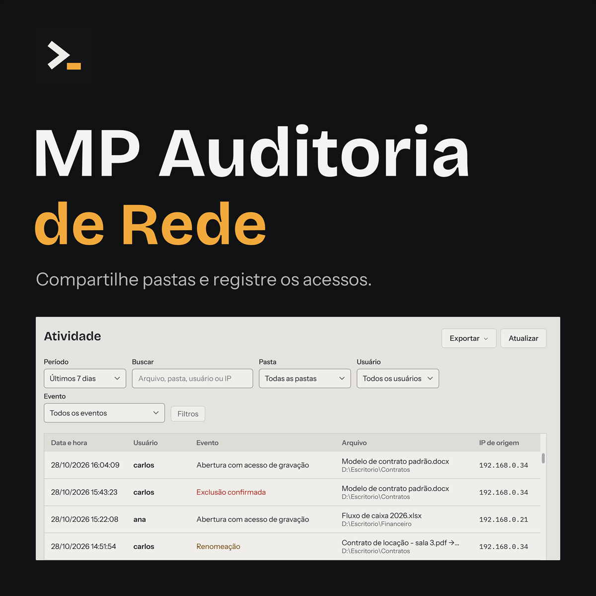
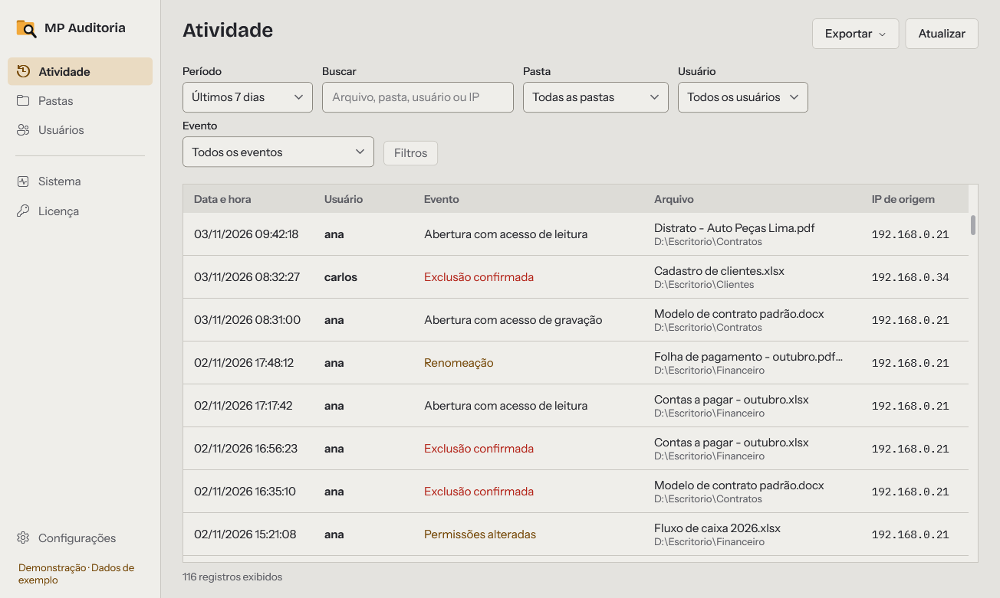
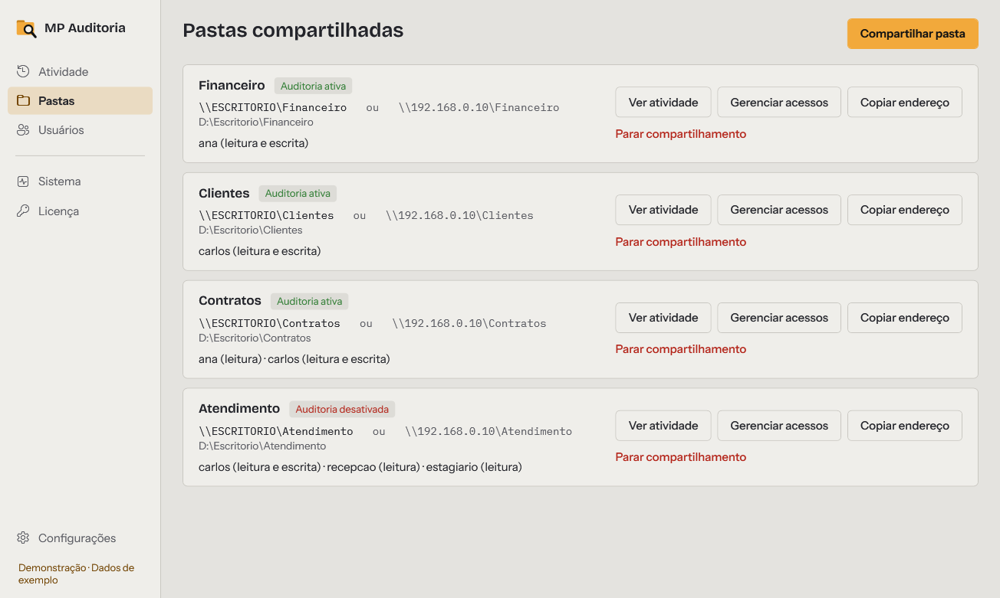
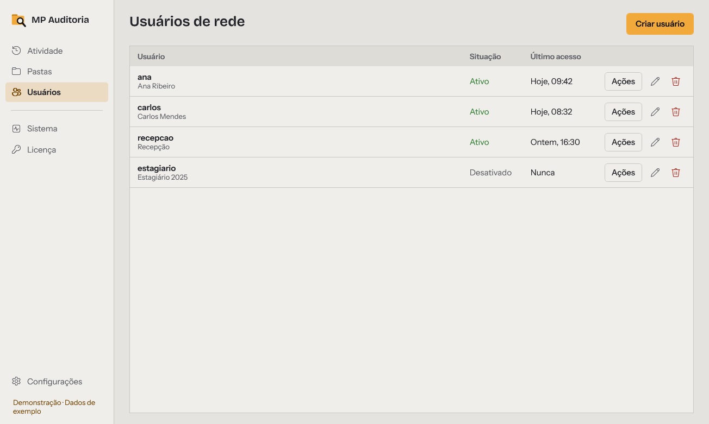

# MP - Auditoria de Rede

Compartilhe pastas na rede local com usuário e senha e veja quem abriu, renomeou ou apagou cada arquivo, com usuário, data, hora e IP do computador de origem.

Programa para Windows, feito para pequenos escritórios e empresas. Pagamento único, sem mensalidade.

**[Comprar ou ver a página do produto](https://murilomachadosp123.hotmart.host/mp-auditoria)** · Teste grátis de 7 dias dentro do programa

## Como funciona

1. **Instalação local.** Instale no computador que guarda as pastas. Os outros computadores acessam pela rede, sem instalar nada.
2. **Controle de acesso.** Crie os usuários de rede, compartilhe as pastas e escolha quais contas podem acessar cada uma.
3. **Atividade registrada.** Consulte o que aconteceu nos arquivos a partir do momento em que as pastas são compartilhadas pelo programa.

## Telas

**Atividade:** busca e filtros por período, pasta, usuário e tipo de evento.

**Pastas compartilhadas:** endereço de rede, acessos de cada conta e situação da auditoria.

**Usuários de rede:** criar, editar, desativar e excluir contas.

As telas usam dados de exemplo.

## Recursos

- **Pastas compartilhadas:** por usuário, somente leitura ou leitura, alteração e exclusão.
- **Usuários de rede:** quem usa a mesma conta aparece como o mesmo usuário.
- **Histórico de arquivos:** aberturas, renomeações (nome antigo e novo) e mudanças de permissão. Exclusões confirmadas quando os registros permitem.
- **Relatórios em PDF e CSV** da atividade registrada.
- **Sem mensalidade:** suporte e atualizações por 3 meses. Depois desse prazo, a versão adquirida continua funcionando.

## Requisitos

- Windows 10 ou 11, de 64 bits, e conta de administrador para instalar e configurar.
- Internet na ativação e nas confirmações, ao menos a cada 30 dias nos primeiros 180 dias. Depois, sem novas confirmações.
- Pastas em disco NTFS do computador ativado. Não monitora NAS nem pastas em outro computador.
- O instalador não tem assinatura digital e pode aparecer como "fornecedor desconhecido".

A auditoria começa após a instalação. Abertura para leitura ou gravação não comprova leitura ou edição do conteúdo. O programa não recupera arquivos apagados nem substitui backup.

## Compra e entrega

Após a aprovação do pagamento pela Hotmart, você recebe por e-mail o link do instalador e a chave de ativação. A chave vale para 1 computador: o que guarda as pastas.

---

O código-fonte é fechado. Este repositório é só a apresentação do programa.

MP Software · [mpsoftwarepro.com](https://mpsoftwarepro.com)
